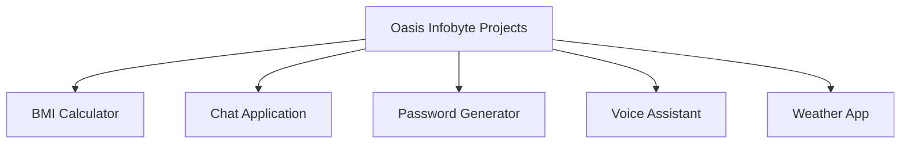

# 🐍 Oasis Infobyte Python Projects

<div align="center">


**Collection of 5 Python Projects from Oasis Infobyte Internship**

[]()
[](https://github.com/samalarakshithbabu/oasis-infobyte-python-projects/issues)

</div>

---

## 🚀 Executive Summary

A **collection of 5 Python programming projects** developed during the Oasis Infobyte internship. Covers health calculation, network communication, security utilities, speech processing, and API integration.

### Projects Overview



---

## ✨ Projects Included

| # | Project | Description | Location |
|---|---------|-------------|----------|
| 1 | **BMI Calculator** | Basic and advanced BMI calculations | `BMI calcutalor/` |
| 2 | **Chat Application** | Real-time messaging with client-server | `chat-app/` |
| 3 | **Password Generator** | Secure password with customization | `Random Password Generator/` |
| 4 | **Voice Assistant** | Speech recognition and commands | `voice-assistant/` |
| 5 | **Weather App** | Weather data with API integration | `weather app/` |

---

## 🛠️ Technology Stack

| Component | Technology |
|-----------|------------|
| **Language** | Python 3 |
| **Networking** | socket |
| **Speech** | SpeechRecognition, pyttsx3 |
| **API** | requests (weather API) |

---

## 📁 Project Structure

```
oasis-infobyte-python-projects/
├── BMI calcutalor/           # BMI calculator
├── chat-app/                 # Chat application (client + server)
├── Random Password Generator/ # Password generator
├── voice-assistant/          # Voice assistant
├── weather app/              # Weather application
└── README.md
```

---

## 🛠️ Installation

```bash
pip install -r requirements.txt
```

### Running Projects

| Project | Command |
|---------|---------|
| **BMI Calculator** | `python bmi_calculator.py` |
| **Chat Server** | `python working_server.py` |
| **Chat Client** | `python working_client.py` |
| **Password Generator** | `python password_generator.py` |
| **Voice Assistant** | `python voice_assistant.py` |
| **Weather App** | `python climate_tracker.py` |

---

## ⚠️ Limitations

| Limitation | Description |
|------------|-------------|
| **Dependencies** | May vary per project |
| **Voice Assistant** | Requires microphone access |
| **Weather App** | Requires API key |

---

## 📄 License

This project is licensed under the MIT License.

---

## 👨‍💻 Author

**SAMALA RAKSHITH BABU**

- 📧 Email: samalarakshithbabu7@gmail.com
- 💼 LinkedIn: [samala-rakshith-babu](https://www.linkedin.com/in/samala-rakshith-babu/)
- 🐙 GitHub: [samalarakshithbabu](https://github.com/samalarakshithbabu)